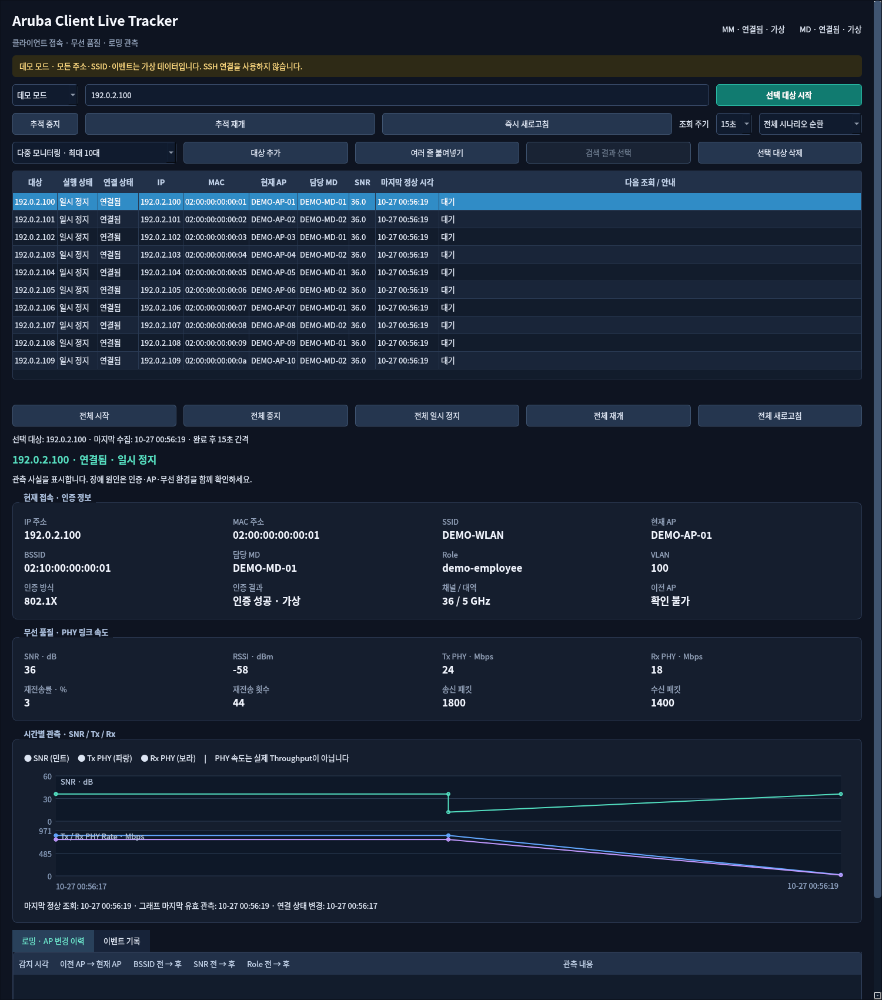

# Aruba Client Live Tracker v0.2.0

ArubaOS 8 환경에서 최대 **10대 무선 클라이언트**의 접속 정보, 무선 품질과 AP 변경을 함께 추적하는 한국어 Windows 데스크톱 도구입니다. 기존 단일 추적도 유지합니다. MM의 `Current switch`를 등록된 MD에 매핑하고 해당 MD만 읽기 전용으로 조회합니다. 실행에 클라우드 서비스가 필요하지 않습니다.

Ubuntu·Windows CI의 자동 테스트 각 **178개**와 Windows EXE의 단일·10대 데모 스모크가 통과했습니다. 실제 Aruba 장비 및 Windows 11 실기 검증은 아직 수행하지 않았습니다. 현재 버전의 자동 테스트·Windows 빌드·EXE 실행 결과는 [검증 기록](docs/BUILD_VALIDATION_KO.md)을 확인하십시오. SSH 실패를 단말 연결 해제로 처리하지 않습니다.



위 이미지는 v0.2.0에서 가상 클라이언트 10대를 추적한 실제 Qt 데모 화면입니다. 운영망 데이터가 아닙니다.

## 다운로드와 실행

공개 저장소는 [sebia1993/aruba-client-live-tracker-](https://github.com/sebia1993/aruba-client-live-tracker-)입니다. **저장소 이름 끝의 하이픈을 포함합니다.** [v0.2.0 Releases](https://github.com/sebia1993/aruba-client-live-tracker-/releases/tag/v0.2.0)에서 **[Windows 실행 ZIP](https://github.com/sebia1993/aruba-client-live-tracker-/releases/download/v0.2.0/ArubaClientLiveTracker_v0.2.0_windows_x64.zip)**, SHA-256 및 대응 소스를 받으십시오. 2026-10-27 게시 완료. 다운로드 파일의 SHA-256과 ZIP 구성도 검증했습니다.

1. `ArubaClientLiveTracker_v0.2.0_windows_x64.zip`과 `.sha256`을 받아 해시를 비교합니다.
2. ZIP 전체를 사용자 폴더에 풀고 `ArubaClientLiveTracker/ArubaClientLiveTracker.exe`를 실행합니다. Python 설치와 관리자 권한은 필요하지 않습니다.
3. 데모 모드에서 단일 추적과 다중 모니터링을 확인합니다.
4. 실제 연결은 장비 설정에 MM/MD 및 `Current switch` 매핑을 등록하고 실행 중 계정을 입력합니다.

코드 서명되지 않은 배포입니다. DLL이 포함된 폴더 전체를 보관하십시오. GitHub의 자동 생성 `Source code (zip)`은 실행 배포가 아닙니다. LGPL 대응 소스 ZIP은 실행 ZIP과 함께 보관·재배포합니다. [한국어 설치 안내](docs/INSTALL_KO.md)

## 주요 기능

- 단일 추적 및 최대 10대 목록·선택 상세, IPv4/MAC 한 줄씩 붙여넣기
- 대상별·전체 시작/중지/일시 정지/재개/새로고침, 공통 10/15/30/60초 주기
- 대상별 IP/MAC·SSID/AP/BSSID/MD·Role/VLAN/인증 정보, SNR·PHY Rate 그래프 및 이벤트
- 대상마다 격리된 상태·세션·오류·수집 시각, 동일 MAC 중복 추적 방지
- 공유 SSH 풀, 장비별 명령 직렬화, 전체 수집 최대 2개 및 연결 최대 12개
- Primary/Standby MM 조회, 담당 MD 전환, 서버 키 최초 승인과 변경 차단
- 대상별·통합 CSV/HTML 보고서 및 기존 SQLite 이력 호환
- 오프라인 단일/10대 데모, 한국어 다크 테마와 지표 도움말

대상 목록은 프로그램 종료 시 사라지며 자동 저장하지 않습니다. 수집 이력은 로컬 SQLite에 남습니다. 값이나 단위를 검증할 수 없으면 **확인 불가**로 표시합니다. PHY Rate는 실제 처리량이 아니며 ClientMatch 과거 측정값을 현재 RSSI로 표시하지 않습니다.

## 개발 환경

Python 3.12 x64를 권장합니다.

```powershell
python -m venv .venv
.venv\Scripts\Activate.ps1
python -m pip install -r requirements-dev.txt
python -m pip install --no-deps -e .
python -m aruba_client_live_tracker.main --demo
python -m aruba_client_live_tracker.main --multi-demo
python -m pytest -q
python -m ruff check src tests scripts
pwsh -File build_windows.ps1 -Version 0.2.0
```

GitHub Actions는 Ubuntu/Windows 자동 검사와 Windows PyInstaller 빌드, 실제 EXE의 단일/10대 GUI 스모크를 수행하도록 구성되어 있습니다. 실행 성공 여부는 해당 Actions 결과와 [검증 기록](docs/BUILD_VALIDATION_KO.md)을 확인하십시오. Linux CI는 Qt offscreen을 사용합니다. PyInstaller는 Windows에서 Windows EXE를 빌드해야 합니다.

## 문서

- [초급 엔지니어 사용 설명서](docs/USER_GUIDE_KO.md)
- [수집 구조](docs/ARCHITECTURE_KO.md) · [CLI 근거와 제한](docs/CLI_COMMANDS_KO.md)
- [자동/실기 테스트 계획](docs/TEST_PLAN_KO.md) · [문제 해결](docs/TROUBLESHOOTING_KO.md)
- [기존 저장소 검토](docs/REFERENCE_REVIEW_KO.md) · [보안 원칙](SECURITY.md)
- [빌드·릴리스 게시 절차](docs/INSTALL_KO.md#저장소와-릴리스-게시)
- [MIT](LICENSE) · [타사 라이선스](THIRD_PARTY_NOTICES.md)

외부 분석, 텔레메트리, 자동 로그 업로드 기능은 없습니다. 운영망 정보는 Git에 추가하지 마십시오.
