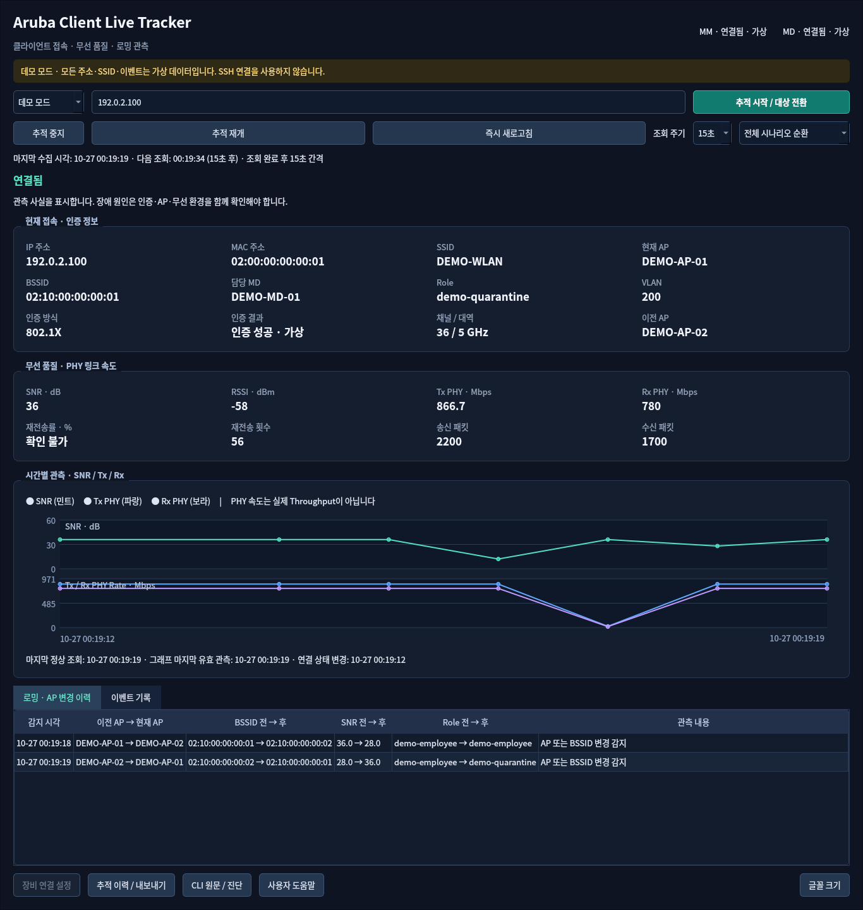

# Aruba Client Live Tracker

ArubaOS 8 환경에서 한 무선 클라이언트의 접속 정보, 무선 품질과 AP 변경을 추적하는 한국어 Windows 데스크톱 도구입니다. MM에서 검색한 `Current switch`를 등록된 MD에 매핑하고 해당 MD만 조회합니다. 모든 장비 명령은 읽기 전용이며, 실행에 클라우드 서비스가 필요하지 않습니다.

> **v0.1.0 검증 범위:** 실제 Aruba 장비 및 Windows 11 실기 검증은 아직 수행하지 않았습니다. 오프라인 자동 테스트와 빌드 결과는 [검증 기록](docs/BUILD_VALIDATION_KO.md)에 구분해 기록합니다. SSH 실패를 연결 해제로 처리하지 않습니다.



이미지는 데모 모드의 가상 데이터입니다. 운영망 화면이 아닙니다.

## 다운로드와 실행

GitHub 저장소 생성 요청은 현재 연결된 integration 권한에서 거부되었습니다. **GitHub Release 다운로드 URL은 아직 없습니다.** 이 작업 결과로 Windows 실행 ZIP `ArubaClientLiveTracker_v0.1.0_windows_x64.zip`을 제작했습니다. 첨부된 실행 ZIP의 `ArubaClientLiveTracker/ArubaClientLiveTracker.exe`를 실행하십시오. Windows EXE를 Wine에서 실행 검증했습니다. Windows 11 실기 검증은 필요합니다. 검증 범위는 [검증 기록](docs/BUILD_VALIDATION_KO.md)을 확인하십시오. GitHub의 `Source code (zip)`은 실행 파일 배포가 아닙니다.

1. Windows x64 실행 ZIP 전체를 사용자 폴더에 압축 해제합니다.
2. `ArubaClientLiveTracker.exe`를 실행합니다. Python 설치와 관리자 권한은 필요하지 않습니다.
3. 먼저 **데모 모드**를 선택해 검색·그래프·이력·내보내기를 확인합니다.
4. 실제 연결은 **장비 설정**에 MM/MD 및 `Current switch` 매핑을 등록하고 실행 중 계정을 입력합니다.

배포 파일은 **코드 서명되지 않았습니다**. SHA-256을 비교하고 파일 출처를 확인하십시오. DLL이 포함된 폴더 전체를 보관해야 합니다. [한국어 설치 안내](docs/INSTALL_KO.md)

## 주요 기능

- IPv4 / MAC 검색, MAC 형식 표준화, 중복 결과의 명시적 선택
- Primary/Standby MM 조회, 등록 매핑에 따른 담당 MD 전환
- IP/MAC, SSID/AP/BSSID/MD, Role/VLAN/인증 정보 표시
- SNR, 검증된 필드의 Tx/Rx PHY Rate, 패킷·재전송 정보와 시각 표시
- 정상 관측 사이 AP/Role/VLAN/인증 변화, 조회 실패·복구 이벤트
- 10/15/30/60초 주기, 시작/중지/일시 정지/즉시 조회, 이전 조회값 표시
- 한국어 다크 테마, 지표 도움말, 이력 및 로컬 CSV/HTML 보고서
- SSH SHA-256 서버 키 최초 승인, 신뢰한 키 변경 차단
- 완전한 오프라인 데모, SQLite 세션 저장, 재현 가능한 자동 테스트

값이 없거나 형식을 확인할 수 없으면 **확인 불가**로 표시합니다. PHY Rate는 실제 처리량(Throughput)이 아니며 ClientMatch 과거 측정값을 현재 RSSI로 표시하지 않습니다. 원인 진단은 관측 사실·추정 원인·추가 확인을 구분합니다.

## 개발 환경

Python 3.12 x64를 권장합니다.

```powershell
python -m venv .venv
.venv\Scripts\Activate.ps1
python -m pip install -r requirements-dev.txt
python -m pip install --no-deps -e .
python -m aruba_client_live_tracker.main --demo
python -m pytest -q
python -m ruff check src tests scripts
pwsh -File build_windows.ps1
```

Linux CI에서는 `QT_QPA_PLATFORM=offscreen`으로 GUI 스모크를 실행합니다. PyInstaller는 OS별 빌드가 필요합니다. Linux용 PyInstaller 산출물을 Windows EXE로 안내하지 않습니다.

## 문서

- [초급 엔지니어 사용 설명서](docs/USER_GUIDE_KO.md)
- [수집 구조](docs/ARCHITECTURE_KO.md) · [CLI 근거와 제한](docs/CLI_COMMANDS_KO.md)
- [자동/실기 테스트 계획](docs/TEST_PLAN_KO.md) · [문제 해결](docs/TROUBLESHOOTING_KO.md)
- [기존 저장소 검토](docs/REFERENCE_REVIEW_KO.md) · [보안 원칙](SECURITY.md)
- [배포·GitHub 게시 절차](docs/INSTALL_KO.md#저장소와-릴리스-게시)
- [MIT](LICENSE) · [타사 라이선스](THIRD_PARTY_NOTICES.md)

외부 분석, 텔레메트리, 자동 로그 업로드 기능은 없습니다. 운영망 정보는 Git에 추가하지 마십시오.
