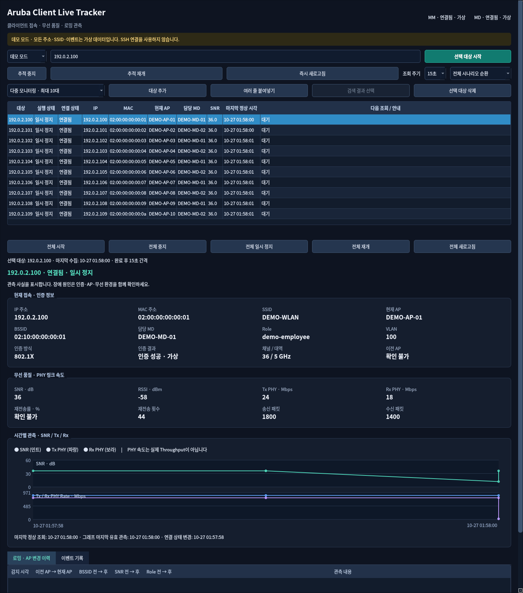
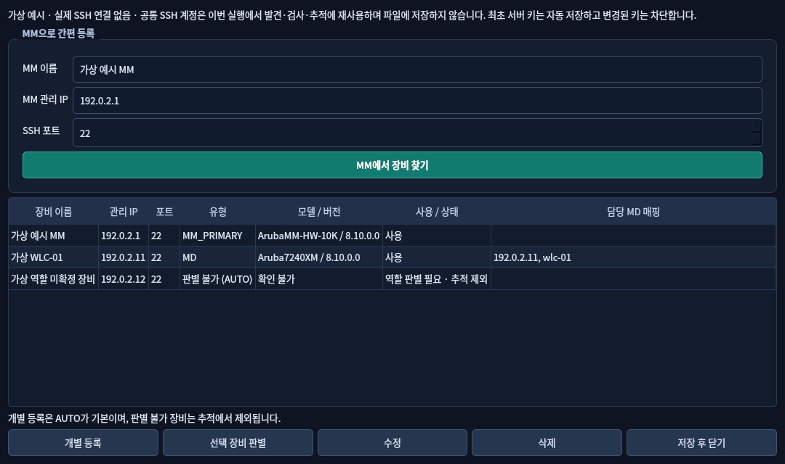
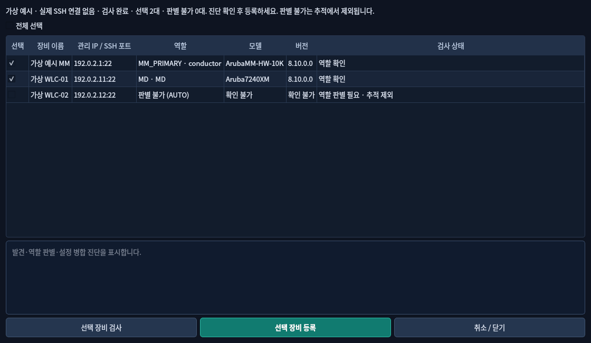

# Aruba Client Live Tracker v0.3.6

ArubaOS 8 환경에서 최대 **10대 무선 클라이언트**의 접속 정보, 무선 품질과 AP 변경을 함께 추적하는 한국어 Windows 데스크톱 도구입니다. MM 이름/IP에서 장비 목록을 발견하고 선택한 장비만 검사하여 등록을 돕습니다. 기존 단일 추적과 수동 MM/MD 설정도 사용할 수 있습니다. MM의 `Current switch`를 등록된 MD에 매핑하여 해당 MD만 읽기 전용으로 조회하며, 실행에 클라우드 서비스가 필요하지 않습니다.

v0.3.6은 SSH 출력의 첫 머리글 들여쓰기와 페이지 경계의 반복 머리글을 처리하고, 빈 주소 셀·짧은 행·주소 형식 오류를 구분합니다. 인계된 안정성 수정과 설정·이력·보고서·소스 패키징 복구도 보완합니다. 주소·행 수 검증, 조회 명령과 자동 TOFU 정책은 유지합니다. 합성 시험과 실제 Aruba 장비의 검증은 구분하며, 9행/0/0의 운영 원인은 아직 확정하지 않았습니다. [현재 검증 기록](docs/BUILD_VALIDATION_KO.md) · [이전 v0.3.5 기록](docs/validation/v0.3.5/BUILD_VALIDATION_KO.md)







위 이미지는 v0.3.0 실제 Qt 프로그램에 합성 데이터를 넣어 캡처했습니다. 운영망 정보는 사용하지 않았습니다.

## 다운로드와 실행

공개 저장소는 [sebia1993/aruba-client-live-tracker-](https://github.com/sebia1993/aruba-client-live-tracker-)입니다. **저장소 이름 끝의 하이픈을 포함합니다.** [Releases](https://github.com/sebia1993/aruba-client-live-tracker-/releases)에서 게시된 Windows 실행 ZIP, SHA-256 및 LGPL 대응 소스를 받으십시오. [v0.3.5 실행 ZIP 다운로드](https://github.com/sebia1993/aruba-client-live-tracker-/releases/download/v0.3.5/ArubaClientLiveTracker_v0.3.5_windows_x64.zip) · [체크섬 및 대응 소스](https://github.com/sebia1993/aruba-client-live-tracker-/releases/tag/v0.3.5). 게시 여부와 실제 다운로드 검증 결과는 [검증 기록](docs/BUILD_VALIDATION_KO.md)을 확인하십시오.

1. 게시된 `ArubaClientLiveTracker_v0.3.5_windows_x64.zip`과 `.sha256`을 받아 해시를 비교합니다.
2. ZIP 전체를 사용자 폴더에 풀고 `ArubaClientLiveTracker/ArubaClientLiveTracker.exe`를 실행합니다. Python 설치와 관리자 권한은 필요하지 않습니다.
3. 데모 모드에서 단일 추적과 다중 모니터링을 확인합니다.
4. 실제 연결은 전체 추적을 중지한 뒤 간편 설정에서 MM 이름/IP와 공통 SSH 계정을 입력합니다. 발견 목록에서 검사할 장비를 선택하고 역할·관리 주소·MD 매핑을 검토한 뒤 저장합니다. 기존 수동 설정도 유지됩니다.

최초 접속 키는 질문이나 별도 동의 옵션 없이 로컬 `known_hosts`에 자동 저장합니다(TOFU). 저장된 키 또는 알고리즘이 바뀌면 인증 전에 연결을 차단합니다. 공통 계정은 앱 실행 중 발견·추적에서 재사용하며 설정 파일과 DB에 저장하지 않습니다. 코드 서명되지 않은 배포입니다. DLL이 포함된 폴더 전체와 LGPL 대응 소스 ZIP을 보관·재배포하십시오. [한국어 설치 안내](docs/INSTALL_KO.md)

## 주요 기능

- MM에서 `show switches`, 선택 장비에서 `show version`·`show switchinfo`로 장비 발견과 식별
- 명시적인 역할 근거만 사용, 불명확한 AUTO 장비는 추적 제외, 기존 수동 유형·주소·매핑 보존
- 공통 SSH 계정 실행 중 재사용, 최초 키 자동 저장과 변경 키 차단
- 연결·키·인증·발견·식별·MM 조회·MD 매핑·MD 명령·해석·무선·저장 단계별 진단
- 단일 추적 및 최대 10대 목록·선택 상세, IPv4/MAC 한 줄씩 붙여넣기
- 대상별·전체 시작/중지/일시 정지/재개/새로고침, 공통 10/15/30/60초 주기
- 대상별 IP/MAC·SSID/AP/BSSID/MD·Role/VLAN/인증 정보, SNR·PHY Rate 그래프 및 이벤트
- 공유 SSH 풀, 장비별 명령 직렬화, 전체 수집 최대 2개 및 연결 최대 12개
- 대상별·통합 CSV/HTML 진단 보고서, 설정 v1 읽기 및 기존 SQLite 자동 업그레이드
- 오프라인 단일/10대 데모, 한국어 다크 테마와 지표 도움말

대상 목록은 프로그램 종료 시 사라지며 자동 저장하지 않습니다. 수집 이력은 로컬 SQLite에 남습니다. 값이나 단위를 검증할 수 없으면 **확인 불가**로 표시합니다. PHY Rate는 실제 처리량이 아니며 ClientMatch 과거 측정값을 현재 RSSI로 표시하지 않습니다. SSH 실패를 단말 연결 해제로 처리하지 않습니다.

## 개발 환경

Python 3.12 x64를 권장합니다.

```powershell
python -m venv .venv
.venv\Scripts\Activate.ps1
python -m pip install -r requirements-dev.txt
python -m pip install --no-deps -e .
python -m aruba_client_live_tracker.main --demo
python -m aruba_client_live_tracker.main --multi-demo
python -m pytest -q
python -m ruff check src tests scripts
pwsh -File build_windows.ps1 -Version 0.3.6
```

GitHub Actions는 Ubuntu/Windows 자동 검사와 Windows 네이티브 PyInstaller onedir 빌드, 실제 EXE의 단일/10대 GUI 스모크를 수행하도록 구성되어 있습니다. 실행 성공 여부는 해당 Actions 결과와 [검증 기록](docs/BUILD_VALIDATION_KO.md)을 확인하십시오. pytest JUnit XML과 스모크 JSON을 아티팩트로 보존합니다. Linux CI는 Qt offscreen을 사용합니다. Windows EXE는 Windows에서 빌드합니다.

## 문서

- [초급 엔지니어 사용 설명서](docs/USER_GUIDE_KO.md)
- [수집 구조](docs/ARCHITECTURE_KO.md) · [CLI 근거와 제한](docs/CLI_COMMANDS_KO.md)
- [자동/실기 테스트 계획](docs/TEST_PLAN_KO.md) · [문제 해결](docs/TROUBLESHOOTING_KO.md)
- [기존 저장소 검토](docs/REFERENCE_REVIEW_KO.md) · [보안 원칙](SECURITY.md)
- [빌드·릴리스 게시 절차](docs/INSTALL_KO.md#저장소와-릴리스-게시)
- [MIT](LICENSE) · [타사 라이선스](THIRD_PARTY_NOTICES.md)

외부 분석, 텔레메트리, 자동 로그 업로드 기능은 없습니다. 운영망 정보는 Git에 추가하지 마십시오.
