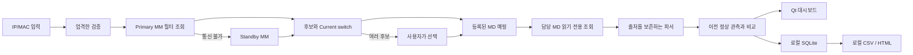

# 구조와 데이터 흐름

독립 Python 패키지 `aruba_client_live_tracker`는 UI, 수집, 해석, 상태 비교, 저장을 분리합니다. 다른 저장소의 런타임 파일을 읽지 않습니다.

`models.py`는 장비/검색 대상/관측/수집 결과/이벤트 계약입니다. `commands.py`는 입력 정규화와 허용 명령만 생성합니다. `parsers.py`는 알려진 출력만 해석하고 불완전한 출력을 0건으로 바꾸지 않습니다. `ssh.py`는 서버 키 검증, 타임아웃, 출력 제한과 연결 수명을 관리합니다. `collector.py`는 MM→MD 선택 및 선택적 지표 수집을 묶습니다.

`tracker.py`는 연결/로밍/정책/품질 이벤트를 결정합니다. 수집 결과가 오류이면 마지막 유효 값을 보존하면서 비교 연속성을 끊습니다. 이전 값을 새 수집 시각의 실제 측정값으로 위장하지 않습니다. `storage.py`는 세션과 관측 및 이벤트를 저장하고 `demo.py`는 같은 수집 인터페이스로 가상 상황을 만듭니다.

Qt UI는 한 번에 하나의 백그라운드 작업만 실행합니다. 중지·대상 변경 시 취소 신호와 작업 세대를 사용해 늦게 도착한 이전 결과가 새 대상에 섞이지 않게 합니다. 서버 키 승인은 UI 스레드에서 지문을 보여주며, 변경된 키에는 자동 승인 경로가 없습니다.

비밀번호는 실행 중 메모리에만 존재합니다. 원문 CLI는 진단을 위한 로컬 정보이며 공개 로그나 Git에 저장하지 않습니다. SSH 연결과 그래프/이벤트 버퍼의 수를 제한합니다. SQLite 이력은 사용자가 관리하는 디스크 기록이므로 장시간 사용 시 크기가 증가할 수 있습니다.
